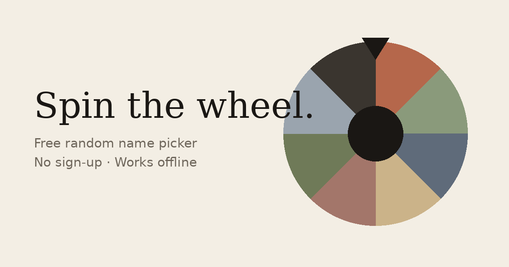
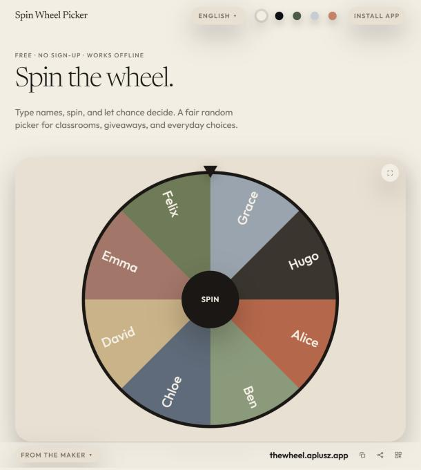

# Spin Wheel Picker

**Type names, spin, and let chance decide. A fair random picker for classrooms, giveaways and everyday choices.**

Free · no sign-up · works offline — [Spin the wheel](https://thewheel.aplusz.app/en/)

---

## Made for quick, fair draws

- **Paste a whole list at once**, or add names one by one
- **Spin with a tap or the Space bar**, full screen for the whole room
- **Shuffle, sort A–Z, import a file**, sound on or off
- **Save your lists** and load them again any time
- Every entry gets **an equal slice**, drawn with your browser's random number generator
- **40 languages**, installable as an app, works offline after the first visit

## For developers and AI agents

The same fair draw, keyless and open-CORS:

- REST: [`/v1/spin`](https://thewheel.aplusz.app/v1/spin?items=Ana,Bo,Cy,Dee) · [`/v1/shuffle`](https://thewheel.aplusz.app/v1/shuffle?items=Ana,Bo,Cy,Dee) · [`/v1/teams`](https://thewheel.aplusz.app/v1/teams?items=Ana,Bo,Cy,Dee,Eve,Fay&teams=2) — [OpenAPI](https://thewheel.aplusz.app/openapi.json)
- MCP server: tools `spin_wheel`, `shuffle_list`, `make_teams`, `list_languages` — [mcp.json](https://thewheel.aplusz.app/.well-known/mcp.json)
- A2A: [agent card](https://thewheel.aplusz.app/.well-known/agent-card.json)

**https://thewheel.aplusz.app/en/**

Made by **Verge Heights** · contact@aplusz.app
